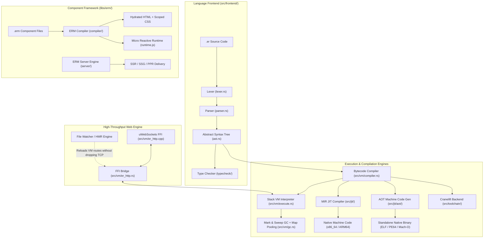

# Eronom Architectural Overview & Internals

Eronom is a high-performance, JIT-compiled scripting runtime, web framework, and reactive template engine written in Rust with native C++ FFI networking bindings.

---

## 1. Language Frontend (`src/frontend/`)

### Lexer & Parser
- **`lexer.rs`**: Transforms raw UTF-8 source text into a stream of tokens (`Token`). It supports string interpolation expressions (`"Hello {user.name}"`), numeric literals, operators, and keywords.
- **`parser.rs`**: A recursive-descent parser producing a strongly-typed Abstract Syntax Tree (`ASTNode` / `Stmt` / `Expr`). Supports struct definitions with embedding (`embed` keyword), pattern matching, closures, loops, and colorless concurrency blocks (`concurrent { ... }`).
- **`ast.rs`**: AST definitions for all grammar nodes with source span locations (`SourceLocation`) for diagnostic reporting.

### Static Type Checker (`src/frontend/typecheck/`)
- Performs static analysis and type inference before execution.
- Generates structured diagnostics with auto-fix recommendations (`TypeError`, `DiagnosticFix`, `TextEdit`).
- Can be invoked via the CLI (`eronom check <file> --json`) to feed machine-readable diagnostics directly to IDEs and AI coding agents.

---

## 2. Virtual Machine & Memory Management (`src/vm/`)

### Instruction Set & Interpreter
- **`compiler.rs`**: Compiles validated AST nodes into linear chunks of 64-bit VM instructions (`Instruction`).
- **`execute.rs`**: Highly optimized bytecode dispatch loop. Evaluates instructions using a register-oriented stack model.
- **Instruction Layout**:
  - `op` (8-bit): OpCode identifier (`LoadConst`, `Call`, `Add`, `GetProperty`, etc.).
  - `ra`, `rb`, `rc` (8-bit each): Register addresses for operands and destinations.
  - `operand` (32-bit): Immediate integer value, constant pool index, or jump offset.

### Garbage Collector (`src/vm/gc.rs`)
- **Mark-and-Sweep**: Heap-allocated dynamic values (`Value::Object`, `Value::Array`, `Value::String`, `Value::Struct`, `Value::Closure`) are traced and swept by the GC.
- **Pooled HashMaps**: To avoid memory fragmentation and high allocator overhead under heavy HTTP request volume, object allocations retrieve pre-allocated maps via `crate::vm::gc::get_pooled_map(capacity)`.
- **Single-Threaded Model**: The core VM execution loop runs in a single thread per script context, eliminating locking overhead and race conditions while maximizing cache locality.

---

## 3. Just-In-Time & Ahead-Of-Time Compilation (`src/jit/`)

### MIR JIT Compiler
- Transforms bytecode chunks into Vladimir Makarov's Medium-Level Intermediate Representation (MIR).
- Compiles hot functions dynamically into native machine code, bypassing the bytecode interpreter loop for compute-intensive blocks.

### Standalone AOT Native Generation (`src/jit/aot/`)
- Eronom includes native object and binary writers:
  - **`elf_writer.rs`**: Generates standalone ELF executables for Linux.
  - **`pe_writer.rs`**: Generates standalone PE64 executables for Windows.
  - **`macho_writer.rs`**: Generates standalone Mach-O executables for macOS.
  - **`linker.rs` & `generator.rs`**: Lowers bytecode directly into target machine code, enabling single-binary deployments without requiring an installed runtime.

### Cranelift Toolchain (`src/toolchain/`)
- Optional pure-Rust native code generation backend accessed via `eronom toolchain add cranelift` and `eronom build --cranelift`.

---

## 4. Networking Engine & Connection-Preserving HMR

### Native C++ `uWebSockets` Layer
- Located in `src/vm/er_http.cpp` and `src/vm/er_http.rs`.
- Leverages kernel event demultiplexing (`epoll` on Linux, `kqueue` on macOS/BSD, and `libuv` on Windows).
- Exposes high-level server primitives (`serve`, `router`, `Response`) directly to Eronom scripts via `std/http`.

### Zero-Downtime Connection-Preserving HMR
Unlike traditional runtimes that restart the process and terminate active TCP connections on code changes:
1. The native C++ networking loop preserves the active TCP listening socket and keep-alive client connections.
2. The file-watcher detects changes to `.er` files or `eronom.toml`.
3. The VM re-parses and re-compiles the script logic, swapping the route dispatch table in-place before the next incoming request.

---

## 5. ERM Reactive Component Engine (`libs/erm/`)

- **Component Compiler (`libs/erm/compiler/`)**: Compiles `.erm` component files into server-rendered HTML with client-side reactive state attachments (`useState`).
- **Scoped CSS (`css.rs`)**: Automatically scopes component styling to avoid global CSS collisions.
- **Rendering Modes**:
  - **SSR (Server-Side Rendering)**: Dynamically renders pages on each request with real-time state.
  - **SSG (Static Site Generation)**: Pre-renders pages at build time into static HTML assets.
  - **PPR (Partial Prerendering)**: Combines static layout shells with dynamic reactive islands.
- **WebSocket HMR**: Livereload engine synchronizing browser DOM changes over a live WebSocket stream without full page refreshes.
